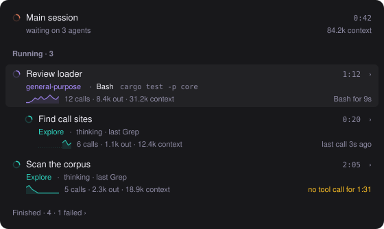
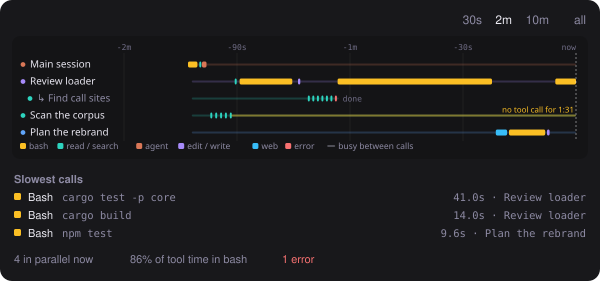

# camplified

Mods for [Claude Code](https://claude.com/claude-code) that show more of what it is doing.

Each mod installs on its own; pick the ones you want.

| Mod | What it does |
| --- | --- |
| [`agents`](mods/agents) | A live side pane of every subagent: what each is doing, its tool calls, tokens and context, and its full transcript |
| [`trace`](mods/trace) | A timeline of every agent's tool calls: what ran in parallel, what was slow, where agents sat idle |

<p>
  
  
</p>

## Install

At the prompt of a Claude Code terminal session:

```
/plugin install agents --marketplace dimay7/camplified
```

Answer `y` to add the camplified marketplace, then pick a scope (Enter takes the user scope, so the mod runs in every session).

The install may end with "1 userConfig option not yet set". That's the mod's daily update check, which is on until you change it with `/plugin configure <mod>@camplified`.

From a shell:

```bash
claude plugin install agents --marketplace dimay7/camplified
```

In the Claude desktop app, where `/plugin` does not run: click **+** next to the prompt box, then **Plugins**, **Add marketplace** with `dimay7/camplified`, then **Add plugin**.

## Updating

Installed mods run the copy made at install time. To get a newer version:

```bash
claude plugin update agents@camplified
```

then `/reload-plugins` in a running session, or start a new one.

To add a mod that was published after you added the marketplace, install it by name, the same way as above. If it says the mod is not found, your copy of the catalogue is older than the mod: refresh it with `claude plugin marketplace update camplified` and try again.

Each mod checks GitHub at most once a day and shows a toast when it has a newer version, or when camplified has a mod you haven't seen. It never installs anything itself, and the check can be turned off in the mod's settings.

What changed in each version is in [CHANGELOG.md](CHANGELOG.md).

## Contributing

New mods and fixes are welcome: see [CONTRIBUTING.md](CONTRIBUTING.md). To report a security problem, see [SECURITY.md](SECURITY.md); please don't open a public issue for it.

## License

[MIT](LICENSE)
