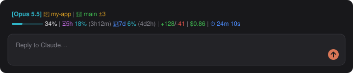

# statusbar

Your Claude Code status line, in the desktop app. The CLI draws the `statusLine` you set under its prompt; the desktop app draws none. This mod runs the same command on the same figures and draws its coloured output above the desktop prompt.



<sub>Sample data.</sub>

## What it shows

- **Your own status line**, whatever it prints: the command in the `statusLine` setting of your `~/.claude/settings.json` (or a project's), run as the CLI runs it, with the JSON it reads on stdin. Its ANSI colours, bold and dim come through, one row per line it prints, in the app's own font. A progress bar it draws in block characters (`███····`) is drawn as a thin bar, since those characters change width in a proportional font.
- **A built-in line** when no `statusLine` is set: model, folder, a context bar, the 5-hour and 7-day rate limits, lines added and removed, cost and time.
- **Why your line is not showing**, in one dim row, when the command fails (a missing `jq`, a non-zero exit, a timeout). The built-in line stands in meanwhile.

The terminal keeps the CLI's own status line: the mod draws nothing there, and runs no command in a session only a terminal shows.

## Install

```
/plugin install statusbar --marketplace dimay7/camplified
```

In the desktop app, where `/plugin` does not run: **+** next to the prompt box, then **Plugins**, **Add marketplace** with `dimay7/camplified`, then **Add plugin**.

`/statusbar` hides the line, in later sessions too; run it again to show it.

## What your command gets

The same fields the CLI writes, read from the session:

| Field | From |
| --- | --- |
| `model.id`, `model.display_name` | the session's model (`Opus 5.5`) |
| `workspace.current_dir`, `workspace.project_dir`, `cwd` | the session's folder and project root |
| `context_window.used_percentage`, `context_window_size`, `total_input_tokens` | the live context window |
| `rate_limits.five_hour`, `rate_limits.seven_day` | `used_percentage`, and `resets_at` in epoch seconds |
| `cost.total_cost_usd`, `cost.total_duration_ms` | the session's cost, and the time since it began |
| `cost.total_lines_added`, `cost.total_lines_removed` | lines the session's edits and writes changed, counted by this mod from when it loaded |
| `session_id`, `version` | the session's id and Claude Code's version |

`transcript_path` and `output_style` are not sent.

## When it reruns

On each turn's start and end, after each tool call, when the context or rate limits move, and every 5 seconds between, so the clock and git state keep up. One run at a time; a run that takes over 5 seconds is cut off.

The command runs with `/bin/sh -c` in the session's folder. An app opened from the Dock may not have your shell profile's `PATH`, so `/opt/homebrew/bin` and `/usr/local/bin` are added to it.

## Settings

| Setting | Default | What it does |
| --- | --- | --- |
| Check for updates | on | Once a day, looks on GitHub for a newer version of this mod and for new camplified mods, and says so in a toast. Nothing is installed automatically. |

## How it works

- `src/run.ts` builds the input, runs the command and keeps the line current; it also counts the lines each edit changes.
- `src/bars.ts` finds those character bars in a row and draws them.
- `src/ansi.ts` turns the command's output into styled runs of text: the 16 colours, the 256, 24-bit colour, bold, dim, italic, underline.
- `src/input.ts` is the input's shape and the built-in line.
- `src/band.tsx` draws the band and answers `/statusbar`.

## Develop

```bash
claude plugin validate mods/statusbar
claude plugin test mods/statusbar
```
